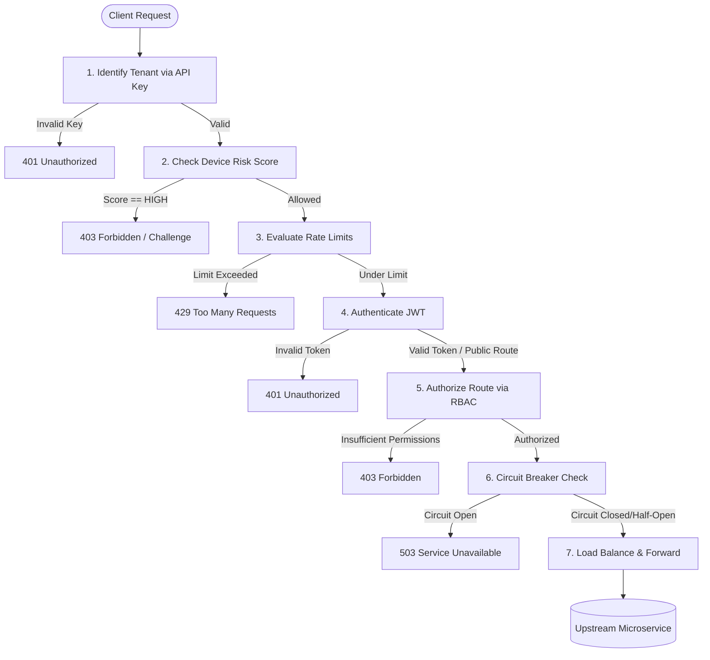
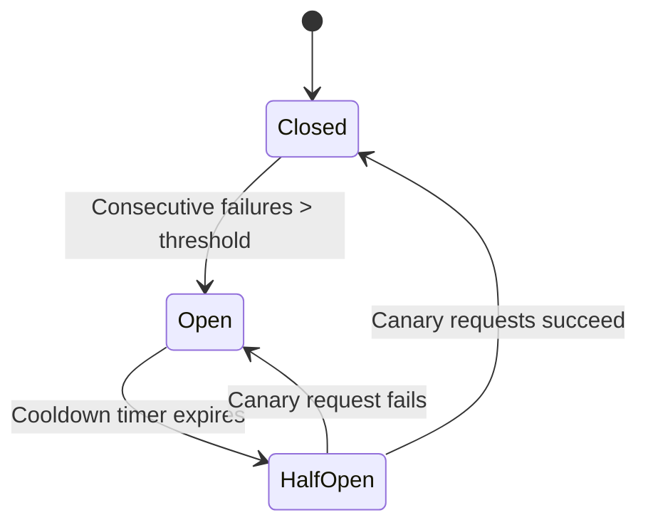

# API Gateway & Auth Platform – Project Documentation

**Date:** November 2026  
**Author:** @Akhil Babu  
**Tech Stack:** Go (Golang), PostgreSQL, Redis, React, TypeScript, Docker, WebAuthn  

---

## 1. Introduction and Abstract

This project is a high-performance developer platform: a **Go reverse-proxy gateway and authentication service** that equips any application with load balancing, rate limiting, circuit breaking, role-based access control (RBAC), multi-tenant isolation, device risk scoring, and biometric passkey (WebAuthn) login without the developer having to build these subsystems from scratch.

### 1.1 Introduction
Every modern backend architecture requires protective infrastructure plumbing before going to production:
* Spreading incoming requests across multiple upstream servers.
* Throttling aggressive or abusive clients to preserve availability.
* Isolating failing microservices to prevent cascading network failures.
* Authenticating end users, handling sessions, and enforcing least-privilege permissions.
* Ensuring rigid multi-tenant isolation so customer data is never leaked.

Engineering teams typically build these features from scratch for each project or glue together separate vendor products (an API gateway, an IAM provider, a fraud/bot prevention engine). The proposed platform bundles these critical capabilities behind a unified, high-performance Go entry point. A developer registers an application, points traffic to the gateway, and configures policies via a developer dashboard. The platform reliably enforces these rules on every incoming request.

### 1.2 Abstract
The system is architected across three core tiers:
1. **The Gateway (Go):** Sits directly in front of the developer's upstream microservices. It executes an ordered, short-circuiting chain of checks: tenant resolution, device-risk inspection, rate limiting, JWT authentication, RBAC authorization, circuit breaker evaluation, and healthy load-balanced reverse proxying.
2. **Auth & Identity Service (Go):** Handles user registration, credentials, token issuance/refresh/revocation, role assignments, tenant boundaries, and WebAuthn passkey ceremonies (enabling biometric authentication via Touch ID, Face ID, or Windows Hello with biometrics never leaving client hardware).
3. **Device Risk Engine (Go):** Ingests client device telemetry (OS, rooted/jailbroken status, emulator detection, integrity signals) via a client SDK, compiles a profile, and assigns an auditable risk score used by the gateway to allow, step-up challenge, or block requests.

Persistent configuration, users, roles, and audit trails reside in **PostgreSQL**. Transient rate-limit counters, token blacklists, and cached lookup tables reside in **Redis**. An administrative and developer portal is provided via a **React / Vite dashboard**.

```
[ Client / Web / Mobile App + SDK ]
                 │
                 ▼
     [ API Gateway (Go Engine) ]
                 │
     ┌───────────┼────────────────────────┐
     ▼           ▼                        ▼
[ Redis ]  [ PostgreSQL ]        [ Upstream Services ]
(Counters) (Configs/Users)       (Orders, Payments, etc.)
```

### 1.3 Target Audience & Intended Users

| Role | Responsibility |
| :--- | :--- |
| **App Developer (Tenant)** | Registers applications, configures routes/upstreams, sets rate limits and RBAC policies, and reviews traffic/audit logs. |
| **End User** | Interacts with the tenant's app, authenticating via standard passwords or biometric passkeys. |
| **Platform Administrator** | Manages system-wide tenants, monitors gateway health, inspects global metrics, and reviews audit trails. |
| **Client SDK** | Collects device security signals and handles native WebAuthn passkey prompts locally. |

---

## 2. Problem Statement and Motivation

### 2.1 Problem Statement
Developers lose weeks of engineering effort repeatedly building boilerplate security and infrastructure features. Rolling custom implementations under tight deadlines frequently leads to subtle yet catastrophic vulnerabilities:
* Unthrottled login and registration endpoints susceptible to credential stuffing and brute-force attacks.
* A single failing downstream microservice causing connection pool exhaustion and bringing down the entire backend.
* Inadvertent cross-tenant data leakage due to missing ownership filters in query logic.
* High latency caused by inefficient or un-cached authorization checks.

### 2.2 Limitations of Existing Approaches
* **Ad-hoc Custom Implementations:** Duplicated effort across services, inconsistent error responses, unvetted cryptographic code, and lack of central auditability.
* **Fragmented Multi-Vendor Tools:** Utilizing separate products for an API gateway (e.g., Kong), identity provider (e.g., Auth0), and fraud detection (e.g., Sift) requires managing multiple bills, disparate SDKs, and disconnected contexts. For instance, standard gateways cannot easily factor device risk into route authorization.
* **Heavyweight Enterprise Suites:** Complex to deploy, configure, and maintain, with steep resource overheads unsuitable for lightweight, modern microservices.
* **Custom Biometric Implementations:** Prone to dangerous anti-patterns, such as attempting to capture biometric images on a server instead of delegating verification to client hardware.

### 2.3 Motivation
* Provide application developers with **secure-by-default infrastructure** configured via a clean UI/API rather than coded from scratch.
* Implement a modern, production-grade zero-trust request lifecycle:  
  `Identify Tenant ➔ Assess Device Risk ➔ Throttle ➔ Authenticate ➔ Authorize ➔ Circuit Break ➔ Load Balance & Proxy`.
* Master low-latency Go concurrency, high-throughput Redis caching, database design in PostgreSQL, and modern cryptographic authentication standards (JWT, Argon2id, WebAuthn).

---

## 3. Objectives and Scope

### 3.1 Core Objectives
1. **Unified Request Pipeline:** Build an extensible Go reverse-proxy gateway executing a short-circuiting chain of checks on every request.
2. **Multi-Tenant Architecture:** Enable instantaneous tenant onboarding, issuing cryptographically hashed API keys, with strict tenant isolation at the gateway, cache, and database layers.
3. **Resilient Rate Limiting:** Enforce distributed per-tenant, per-IP, and per-route rate limits via Redis sliding windows.
4. **Traffic Distribution & Resilience:** Implement round-robin and least-connections load balancing coupled with active background health checks and automated circuit breaking.
5. **Robust IAM & RBAC:** Provide tenant-scoped authentication (Argon2id password hashing, short-lived JWTs, sliding refresh tokens) and path-based RBAC with deny-by-default security.
6. **Device Intelligence & Risk Scoring:** Convert client technical telemetry into transparent, rule-driven risk scores that gate sensitive API routes.
7. **Biometric Passkey Authentication:** Implement WebAuthn registration and authentication ceremonies where biometric data remains isolated on client hardware.
8. **Observability & Auditability:** Structured JSON logging, correlation request IDs, Prometheus metrics, and immutable audit logs omitting sensitive credentials.

### 3.2 In Scope (MVP & Core Platform)
* Developer registration, tenant lifecycle, and API key management (SHA-256 hashed).
* Reverse proxy engine leveraging Go's `httputil.ReverseProxy` with request sanitization, dynamic rewriting, and custom error handlers.
* Health-aware load balancing (Round-Robin, active ping health checks).
* Distributed sliding-window rate limiting in Redis.
* Circuit breaker state machine (Closed, Open, Half-Open) per upstream.
* Tenant-isolated user authentication with JWT access tokens, refresh token rotation, and RBAC policy evaluation.
* Device telemetry ingestion and deterministic rule-based risk scoring.
* React + Vite + Tailwind CSS developer management dashboard.
* Comprehensive test suites: unit, integration, and load testing (via k6/vegeta).

### 3.3 Out of Scope
* Server-side biometric recognition (strictly disallowed; all biometric checks execute via device authenticators using WebAuthn).
* Cross-site tracking or covert spyware-style device tracking.
* Non-deterministic black-box machine learning models for risk scoring.
* Multi-region active-active database clustering (single-region multi-node topology is used for this phase).

---

## 4. Architectural Deep Dive & Request Lifecycle

Every HTTP request reaching the gateway executes in a strict order designed to reject malicious, abusive, or invalid requests early before consuming downstream computational resources.



### 4.1 Step-by-Step Request Chain

1. **Tenant Identification (O(1) Redis Lookup):**
   * Inspects `X-API-Key` or `Authorization: Bearer <key>`.
   * Hashes key via SHA-256 and checks Redis key cache (`cache:tenant_keys:<hash>`).
   * Fallback to PostgreSQL if cache miss. Inactive or missing keys immediately abort with `401 Unauthorized`.
2. **Device Risk Evaluation:**
   * Extracts device fingerprint/hash from request headers.
   * Fetches latest risk assessment from Redis cache.
   * If route policy requires `LOW`/`MEDIUM` risk and device is flagged `HIGH` (e.g., emulator + rooted), rejects with `403 Forbidden` (or returns a step-up challenge requirement).
3. **Distributed Rate Limiting:**
   * Evaluates limits using Redis atomic sliding-window Lua scripts.
   * Tracks limits per tenant, client IP, and specific route pattern.
   * Returns `429 Too Many Requests` with standard `Retry-After`, `X-RateLimit-Limit`, and `X-RateLimit-Remaining` headers on exhaustion.
4. **JWT Authentication:**
   * If the route requires authentication, parses and verifies the JWT signature and expiration locally using the platform's public key (asymmetric RS256/EdDSA) or HMAC secret.
   * Extracts `user_id`, `tenant_id`, and assigned `roles`.
5. **RBAC Authorization (Deny-by-Default):**
   * Matches the HTTP method and route against tenant-defined access policies.
   * Verifies that the token's tenant matches the gateway context (cross-tenant rejection).
   * Verifies user roles against route allowances. Unmatched or unpermitted routes abort with `403 Forbidden`.
6. **Circuit Breaker Evaluation:**
   * Verifies the target upstream service status (`CLOSED`, `OPEN`, `HALF-OPEN`).
   * If `OPEN`, fails fast immediately with `503 Service Unavailable`, preventing thread starvation and upstream exhaustion.
7. **Reverse Proxying & Upstream Dispatch:**
   * Removes untrusted client identity headers (`X-User-Id`, `X-Tenant-Id`, `X-User-Role`).
   * Injects sanitized, verified gateway headers (`X-Tenant-Id`, `X-User-Id`, `X-User-Role`, `X-Request-Id`, `X-Forwarded-For`).
   * Selects an active, healthy upstream instance (via Round-Robin or Least-Connections).
   * Dispatches request via connection-pooled HTTP client with context timeouts and cancellation propagation.

---

## 5. Core Platform Features

### 5.1 Reverse Proxy Engine
* **Single Public Ingress:** Backend microservices remain bound to private network interfaces; clients only communicate with the gateway.
* **Header Sanitization:** Strips client-supplied identity assertions to prevent header-spoofing attacks against internal services.
* **Context Propagation:** Upstream calls respect client cancellations; if a client disconnects, downstream requests are aborted immediately.
* **Standardized Gateway Errors:** Upstream timeouts or connection resets are converted into structured JSON errors with HTTP `502 Bad Gateway` or `504 Gateway Timeout`.

### 5.2 Multi-Tenant Isolation Model
Multi-tenancy is defended across three distinct boundaries:
1. **Edge/Gateway Layer:** The active tenant context is derived solely from validated cryptographic keys or tokens. Client-provided tenant overrides are stripped.
2. **Database Layer:** All tables containing business domain records enforce `tenant_id` foreign keys and composite indexes `(tenant_id, id)`. Queries strictly enforce `WHERE tenant_id = $1`. PostgreSQL Row-Level Security (RLS) is used as an additional defense-in-depth layer.
3. **Cache Layer:** All Redis keys are strictly namespaced by tenant (e.g., `tenant:<tenant_id>:ratelimit:<client_ip>`).

### 5.3 Load Balancing & Resilient Health Checking
* **Algorithms:**
  * *Round-Robin:* Distributes requests sequentially across healthy upstream instances.
  * *Least-Connections:* Dynamically routes to the upstream with the fewest active in-flight requests.
* **Active Health Checker:** Periodically queries upstream health check endpoints (e.g., `GET /healthz`) on a background goroutine. Instances failing $N$ consecutive health probes are evicted from rotation until passing $M$ consecutive recovery probes.

### 5.4 Circuit Breaker State Machine
Implemented to prevent cascading failures across services:
* **Closed:** Normal traffic flow. Upstream errors (HTTP 5xx, timeouts) increment failure counters.
* **Open:** When failure rate exceeds threshold (e.g., 5 consecutive failures or >50% failure rate over window), circuit trips. All requests immediately receive `503 Service Unavailable` for a configurable cooldown window (e.g., 30s).
* **Half-Open:** Following cooldown expiration, a limited canary probe of trial requests is permitted through. If successful, the circuit resets to `Closed`. If failures persist, the circuit resets to `Open`.



### 5.5 Authentication & WebAuthn Passkeys
* **Password Authentication:** High-security password hashing using **Argon2id** (memory-hard, resistant to GPU/ASIC attacks) with unique cryptographically random salts.
* **Dual-Token System:**
  * *Access Tokens:* Stateless, short-lived JWTs (15-minute TTL) containing `user_id`, `tenant_id`, and `roles`. Verified locally at the gateway without database latency.
  * *Refresh Tokens:* Stateful, long-lived (7–30 day TTL), cryptographically random tokens stored hashed in PostgreSQL. Supports automatic rotation and revocation families.
* **WebAuthn / Passkey Ceremonies (FIDO2):**
  * *Registration:* Server issues a cryptographically secure random challenge. The client authenticator creates an asymmetric keypair unlocked by user biometric (Touch ID/Face ID/Windows Hello) and signs the challenge. The server persists only the public key, credential ID, and signature counter.
  * *Authentication:* Server issues a challenge; authenticator unlocks private key and signs; server verifies signature against stored public key and increments counter (replay attack defense).
  * **Zero Biometric Exposure:** Server never receives, processes, or stores any biometric data or imagery.

### 5.6 Device Telemetry & Risk Engine
* **Signal Collection:** Client SDK gathers technical signals including OS version, package signature verification, rooted/jailbroken indicators, emulator environment flags, and network anomalies.
* **Server-Side Scoring:** Calculations execute strictly on the server:
  * Emulator detected: $+30$ points
  * Rooted / Jailbroken device: $+40$ points
  * Suspicious network / proxy: $+20$ points
* **Tiers:**
  * `0 – 30`: **LOW** (Standard access)
  * `31 – 60`: **MEDIUM** (Monitored or non-critical action)
  * `61 – 100`: **HIGH** (Restricted; requires step-up MFA/passkey or block)

---

## 6. Database Schema Design (PostgreSQL)

Every tenant-owned table enforces referential integrity through foreign keys linked to `tenants(tenant_id)`:

```
┌─────────────────────────────────┐       ┌─────────────────────────────────┐
│             tenants             │       │            api_keys             │
├─────────────────────────────────┤       ├─────────────────────────────────┤
│ tenant_id: UUID (PK)            │◄──────│ key_id: UUID (PK)               │
│ name: VARCHAR(100)              │       │ tenant_id: UUID (FK)            │
│ status: VARCHAR(20)             │       │ key_hash: VARCHAR(64) [UNIQUE]  │
│ created_at: TIMESTAMPTZ         │       │ label: VARCHAR(50)              │
└────────────────┬────────────────┘       │ status: VARCHAR(20)             │
                 │                        └─────────────────────────────────┘
                 │
                 ├───────────────────────────────┐
                 ▼                               ▼
┌─────────────────────────────────┐       ┌─────────────────────────────────┐
│            upstreams            │       │             routes              │
├─────────────────────────────────┤       ├─────────────────────────────────┤
│ upstream_id: UUID (PK)          │       │ route_id: UUID (PK)             │
│ tenant_id: UUID (FK)            │       │ tenant_id: UUID (FK)            │
│ upstream_group: VARCHAR(50)     │       │ method: VARCHAR(10)             │
│ address: VARCHAR(255)           │       │ path_pattern: VARCHAR(255)      │
│ weight: INT                     │       │ upstream_group: VARCHAR(50)     │
│ healthy: BOOLEAN                │       │ auth_required: BOOLEAN          │
└─────────────────────────────────┘       │ risk_policy: VARCHAR(20)        │
                                          └────────────────┬────────────────┘
                                                           │
                                                           ▼
┌─────────────────────────────────┐       ┌─────────────────────────────────┐
│              users              │       │         route_policies          │
├─────────────────────────────────┤       ├─────────────────────────────────┤
│ user_id: UUID (PK)              │       │ policy_id: UUID (PK)            │
│ tenant_id: UUID (FK)            │       │ tenant_id: UUID (FK)            │
│ email: VARCHAR(255)             │       │ route_id: UUID (FK)             │
│ password_hash: VARCHAR(255)     │       │ role_id: UUID (FK)              │
│ created_at: TIMESTAMPTZ         │       └─────────────────────────────────┘
└────────────────┬────────────────┘
                 │
                 ├───────────────────────────────┐
                 ▼                               ▼
┌─────────────────────────────────┐       ┌─────────────────────────────────┐
│            passkeys             │       │             devices             │
├─────────────────────────────────┤       ├─────────────────────────────────┤
│ credential_id: BYTEA (PK)       │       │ device_id: UUID (PK)            │
│ tenant_id: UUID (FK)            │       │ tenant_id: UUID (FK)            │
│ user_id: UUID (FK)              │       │ device_hash: VARCHAR(64)        │
│ public_key: BYTEA               │       │ os: VARCHAR(50)                 │
│ sign_count: BIGINT              │       │ is_emulator: BOOLEAN            │
│ created_at: TIMESTAMPTZ         │       │ is_rooted: BOOLEAN              │
└─────────────────────────────────┘       └─────────────────────────────────┘
```

---

## 7. API Specification

### 7.1 Developer Control Plane API
* `POST /api/v1/tenants` — Register a new tenant account.
* `POST /api/v1/tenants/{id}/keys` — Generate or rotate an API key (returns plain key once; stores SHA-256 hash).
* `POST /api/v1/upstreams` — Register backend server addresses into upstream groups.
* `POST /api/v1/routes` — Configure routing path patterns, target upstream groups, and security policies.
* `PUT  /api/v1/routes/{id}/rate-limit` — Configure rate limiting thresholds (limit, window).
* `PUT  /api/v1/routes/{id}/policy` — Bind roles and minimum risk requirements to routes.
* `GET  /api/v1/audit-logs` — Query security and operational audit trails (paginated).
* `GET  /api/v1/metrics` — View traffic distribution, 429/403 rejections, and latency stats.

### 7.2 End-User Authentication API
* `POST /auth/register` — User signup with email and password.
* `POST /auth/login` — Password authentication; returns JWT access and refresh tokens.
* `POST /auth/refresh` — Exchange refresh token for a newly minted access token.
* `POST /auth/logout` — Invalidate refresh token and add access token to Redis blacklist.
* `POST /auth/passkey/register/begin` — Generate WebAuthn credential creation options and challenge.
* `POST /auth/passkey/register/finish` — Verify signed client challenge and register public key.
* `POST /auth/passkey/login/begin` — Generate WebAuthn assertion options and challenge.
* `POST /auth/passkey/login/finish` — Verify assertion signature and issue session tokens.

### 7.3 Telemetry Ingestion API
* `POST /telemetry` — Accepts encrypted client hardware signals. Requires idempotent `event_id`.
* `GET  /devices/{id}/risk` — Retrieve latest calculated score, level, and triggered rule identifiers.

---

## 8. Failure Handling & Non-Functional Requirements

### 8.1 Redis Degradation Strategies
When Redis becomes temporarily unavailable, the gateway adheres to explicitly defined failure modes per component:

| Feature | Policy | Rationale |
| :--- | :--- | :--- |
| **Rate Limiter** | **Fail Open** | Never drop legitimate customer traffic due to telemetry counter outages. Log error alert. |
| **Token Blacklist** | **Fail Closed** | Security priority: Reject revoked tokens or fall back to short JWT TTL expiration. |
| **Tenant Key Cache** | **Fallback to PostgreSQL** | Direct database lookup with local memory caching to sustain verification. |

### 8.2 Security & Data Hygiene
* **Zero Plaintext Secrets:** Passwords hashed with Argon2id; API keys hashed with SHA-256; Passkeys store asymmetric public keys only.
* **Deny-by-Default:** Routes without explicit role policies reject requests automatically.
* **Log Sanitization:** Sensitive authorization headers, session cookies, and request bodies containing credentials are scrubbed by logging middleware prior to emission.

---

## 9. Testing Strategy & Acceptance Verification

### 9.1 Verification Scenarios
* **TC-01 (Reverse Proxying):** Valid requests with verified API keys are proxied to the correct upstream with injected context headers.
* **TC-02 (Key Enforcement):** Tampered or absent API keys receive `401 Unauthorized`.
* **TC-03 (Rate Limiting Burst):** Triggering requests above configured thresholds returns `429 Too Many Requests` containing `Retry-After`.
* **TC-04 (Multi-Gateway Rate Limiting):** Two independent gateway instances sharing one Redis node correctly count toward a shared limit.
* **TC-05 (Fault Tolerance & Failover):** Terminating 1 of 3 upstream instances causes traffic to automatically balance across the remaining 2 with 0 dropped requests.
* **TC-06 (Circuit Breaker Tripping):** Forcing an upstream to return 500s trips the circuit to `OPEN`, immediately returning `503 Service Unavailable` without exhausting gateway connections.
* **TC-07 (Cross-Tenant Isolation):** Requests from Tenant A containing resource IDs owned by Tenant B return `404 Not Found` or `403 Forbidden` and trigger an audit alert.
* **TC-08 (Passkey Cryptographic Replay):** Submitting an expired or replayed WebAuthn challenge fails signature verification.

---

## 10. Project Directory Layout

```
apigateway/
├── cmd/
│   ├── gateway/            # Gateway reverse-proxy executable entrypoint
│   ├── auth/               # IAM & Passkey auth service executable
│   └── control/            # Developer control-plane API service
├── internal/
│   ├── proxy/              # Reverse proxy engine & director rewriting
│   ├── middleware/         # Pipeline: tenant, risk, rate limit, auth, RBAC
│   ├── ratelimit/          # Redis sliding-window Lua implementation
│   ├── breaker/            # Circuit breaker state machine
│   ├── balancer/           # Round-robin & least-connections load balancers
│   ├── auth/               # JWT token manager & Argon2id hasher
│   ├── passkey/            # WebAuthn ceremonies implementation
│   ├── risk/               # Telemetry ingestion & rule assessment engine
│   ├── storage/            # PostgreSQL repositories (sqlc/pgx) & migrations
│   └── config/             # Environment & configuration loading
├── web/                    # React + Vite developer dashboard
├── deployments/            # Dockerfiles & docker-compose.yml
├── docs/                   # Architectural guides, diagrams & OpenAPI specs
└── tests/                  # Integration & k6 load testing scripts
```
