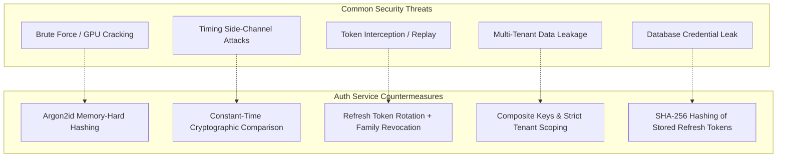

# Auth & Identity Service – Architecture & Specification

**Date:** November 2026  
**Document:** Service Architecture & Specification  
**Component:** `auth-service` (Path A: Multi-Tenant Credentials, JWT & RBAC Engine)  
**Author:** @Akhil Babu  

---

## 1. Executive Summary & Purpose

The **Auth & Identity Service** is the central authentication and access control engine for the API Gateway platform. Its fundamental mission is to provide an **isolated, multi-tenant authentication provider** that downstream microservices and external developers can plug into without implementing user tables, password hashing, token rotations, or authorization checks themselves.

### 1.1 The Core Purpose
In distributed architectures, managing user identities across multiple tenants (apps, companies, or organizations) is fraught with risk. If every downstream microservice attempts to authenticate users individually:
* Security boundaries become fragmented and difficult to audit.
* Database schemas get polluted with redundant authentication logic.
* Vulnerabilities like broken object-level authorization (BOLA/IDOR), timing attacks, and token theft proliferate.

The Auth Service centralizes these concerns into a **hardened, high-performance Go microservice**. It answers two critical questions for every request entering the platform:
1. **Authentication (AuthN):** *Who are you, and can you cryptographically prove it?*
2. **Authorization (AuthZ):** *What tenant do you belong to, and what actions are you permitted to execute?*

---

## 2. Why We Need a Dedicated Auth Service

### 2.1 The Problem with Embedded / Ad-Hoc Auth
When software teams build authentication directly into their business applications, common structural flaws arise:
* **Duplicated Engineering Effort:** Teams rebuild login, registration, password hashing, and session management for every new service or project.
* **Inconsistent Cryptographic Standards:** One team might use outdated MD5/SHA-256 for passwords, another uses Bcrypt with inadequate work factors, and another forgets constant-time comparison, opening the system up to timing side-channel attacks.
* **Tight Coupling:** Downstream business services (e.g., Orders, Payments, Inventory) become tightly coupled to user credentials and authentication databases, violating separation of concerns.
* **Cross-Tenant Data Bleed:** Without strict, centralized tenant scoping, developers frequently make subtle SQL mistakes (e.g., omitting `WHERE tenant_id = $1`), allowing Customer A to access Customer B's resources.

### 2.2 Why We Decided to Centralize It
By isolating authentication into its own dedicated service alongside the API Gateway:
1. **Zero-Trust Perimeter:** Downstream microservices never handle raw passwords or inspect cryptographic signatures. They simply receive pre-validated, sanitized context headers (`X-User-Id`, `X-Tenant-Id`, `X-User-Roles`) from the gateway.
2. **Multi-Tenant by Design:** Every user, role, and session is strictly bounded by a `tenant_id`. Two different tenants can have users with the exact same email address (`alice@example.com`) with zero collisions or data leakage.
3. **Defense in Depth:** Security updates, password hashing upgrades (e.g., tuning Argon2id memory limits), and session revocation strategies happen in one place without touching business services.

---

## 3. Technology Stack & Technical Rationale

The technology stack is carefully selected for **high throughput, memory safety, cryptographic resilience, and minimal latency**.

| Layer / Concern | Technology | Technical Rationale & Justification |
| :--- | :--- | :--- |
| **Language** | **Go (Golang)** | High concurrency via lightweight goroutines, near-zero startup time, low memory footprint, and strong standard libraries (`crypto/rand`, `crypto/subtle`). |
| **Database** | **PostgreSQL 16+** | ACID-compliant relational storage, foreign key constraints for multi-tenant isolation, UUID generation (`pgcrypto`), and robust indexing. |
| **Password Hashing** | **Argon2id** (`golang.org/x/crypto/argon2`) | Winner of the Password Hashing Competition. Combining Argon2d and Argon2i makes it memory-hard and computationally expensive, giving the highest resistance against GPU/ASIC-based brute-force attacks. |
| **Token Framework** | **JWT (JSON Web Tokens)** (`github.com/golang-jwt/jwt/v5`) | Stateless access tokens (15-minute TTL) signed with HMAC-SHA256 (or asymmetric RS256/EdDSA). Allows the API Gateway to verify identity locally without querying the database. |
| **Refresh Tokens** | **Opaque Cryptographic Strings** (`crypto/rand`) | 32-byte secure random tokens stored hashed (`SHA-256`) in PostgreSQL. Enforces token rotation and detects token theft via family revocation. |
| **HTTP Transport** | **Go `net/http` / `Chi` Router** | Idiomatic, composable HTTP middleware architecture with zero third-party lock-in and minimal overhead. |
| **Driver / ORM** | **`pgx/v5`** | High-performance, native PostgreSQL driver for Go supporting connection pooling, prepared statements, and binary row parsing. |

---

## 4. Key Features & Functional Specifications

```
                       ┌─────────────────────────────────────────┐
                       │           Auth Service Engine           │
                       └────────────────────┬────────────────────┘
                                            │
        ┌───────────────────────────────────┼───────────────────────────────────┐
        ▼                                   ▼                                   ▼
┌───────────────────────┐       ┌───────────────────────┐       ┌───────────────────────┐
│ 1. User Management    │       │ 2. Cryptographic Auth │       │ 3. RBAC & Claims      │
├───────────────────────┤       ├───────────────────────┤       ├───────────────────────┤
│ • Tenant-scoped users │       │ • Argon2id hashing    │       │ • Role assignment     │
│ • Email uniqueness    │       │ • JWT minting (15m)   │       │ • Tenant boundary     │
│ • Account lifecycle   │       │ • Rotated refresh     │       │ • Context injection   │
│   (Active/Suspended)  │       │ • Family revocation   │       │   for Gateway         │
└───────────────────────┘       └───────────────────────┘       └───────────────────────┘
```

### 4.1 Multi-Tenant Registration (`POST /auth/register`)
* **Purpose:** Registers a new end-user under a designated tenant.
* **Mechanism:**
  1. Resolves `tenant_id` from the request header (`X-Tenant-ID`) or route parameter.
  2. Validates that the requested tenant exists and is in an `ACTIVE` state.
  3. Validates email format and enforces strong password criteria (minimum 8 characters, entropy checks).
  4. Checks for duplicate registration using composite index `(tenant_id, email)`. Returns `409 Conflict` if existing.
  5. Computes a salted **Argon2id** hash using cryptographically random 16-byte salt.
  6. Persists the user record and automatically assigns default tenant roles (e.g., `member`).

### 4.2 Multi-Tenant Login (`POST /auth/login`)
* **Purpose:** Authenticates user credentials and issues session token pairs.
* **Mechanism:**
  1. Locates user record by `(tenant_id, email)`.
  2. If the user does not exist or status is `SUSPENDED`, returns generic `401 Unauthorized` (prevents user enumeration).
  3. Verifies input password against stored Argon2id hash using **`subtle.ConstantTimeCompare`** to prevent side-channel timing leaks.
  4. Queries user roles assigned within this tenant.
  5. Generates a new `family_id` (UUIDv4) to track this login session.
  6. **Mints Token Pair:**
     * **Access Token (JWT):** Signed token containing `sub` (user ID), `tid` (tenant ID), `email`, and `roles`. Valid for 15 minutes.
     * **Refresh Token:** 32-byte cryptographically secure random string. The server hashes it via `SHA-256` and persists it in PostgreSQL along with `family_id` and expiration timestamp (7 days).
  7. Returns both tokens to the client.

### 4.3 Refresh Token Rotation & Replay Detection (`POST /auth/refresh`)
* **Purpose:** Obtains a fresh access token without re-entering credentials, while detecting stolen tokens.
* **The Problem It Solves:** If a refresh token is compromised by an attacker, standard static refresh tokens allow perpetual unauthorized access.
* **The Solution (Rotation with Family Revocation):**
  1. Client sends the current refresh token.
  2. Server calculates `SHA-256(raw_token)` and looks it up in PostgreSQL.
  3. **Replay Detection Case (Token Theft):** If the token is found but **already marked as used/revoked (`is_revoked = TRUE`)**, an attacker or victim has reused an old token. The service immediately invalidates the entire `family_id`. All active sessions for that login lineage are revoked immediately.
  4. **Normal Rotation Case:** If the token is valid and unrevoked:
     * Mark the old refresh token as revoked (`is_revoked = TRUE`).
     * Issue a *new* Access Token.
     * Issue a *new* Refresh Token associated with the **same** `family_id`.
     * Return the new token pair to the client.

### 4.4 Session Revocation & Logout (`POST /auth/logout`)
* **Purpose:** Safely terminates user sessions.
* **Mechanism:**
  1. Hashes incoming refresh token via SHA-256.
  2. Sets `is_revoked = TRUE` in PostgreSQL.
  3. Optionally publishes the access token's `jti` (JWT ID) to a Redis blocklist until natural expiry (15m).

### 4.5 Role-Based Access Control (RBAC)
* **Purpose:** Granular access governance per route.
* **Mechanism:**
  * Tenants define distinct roles (e.g., `admin`, `editor`, `viewer`, `customer`).
  * When a user logs in, their roles are embedded directly into the access token payload.
  * The API Gateway inspects these roles against route policies (e.g., `DELETE /api/v1/orders/*` requires `admin`) without querying the database on every request.

---

## 5. Security Principles & Threat Mitigations



1. **Memory-Hard Hashing:** Argon2id requires 64 MB of RAM and multiple iterations per hash, making parallel GPU/ASIC dictionary cracking economically unfeasible.
2. **Zero-Knowledge Token Storage:** Raw refresh tokens are never stored in the database. Only their SHA-256 hashes are persisted. If the PostgreSQL database is compromised, an attacker cannot authenticate or impersonate sessions.
3. **Strict Composite Isolation:** Every query strictly asserts `tenant_id`. Unique constraints prevent identity collision between tenants (`UNIQUE(tenant_id, email)`).
4. **Short-Lived Ephemeral Access:** Access tokens live for only 15 minutes, minimizing the vulnerability window if a client-side JWT is ever intercepted.

---

## 6. How the Gateway Uses the Auth Service

The Gateway and Auth Service work in a clean **decoupled symbiosis**:

```
[ Client ] ──────── (1) Authenticates (/auth/login) ───────► [ Auth Service ]
    │                                                               │
    │ ◄─────── (2) Receives JWT Access Token (15m TTL) ─────────────┘
    │
    │
    │ ─────── (3) Request to /api/orders (Bearer JWT) ────────► [ API Gateway ]
                                                                     │
                                                       (4) Validates JWT signature
                                                           locally (0ms DB latency)
                                                                     │
                                                       (5) Injects verified headers:
                                                           X-User-Id: 123
                                                           X-Tenant-Id: 456
                                                           X-User-Roles: admin
                                                                     │
                                                                     ▼
                                                          [ Upstream Orders App ]
```

1. **Issuance:** The **Auth Service** handles complex verification (checking passwords, updating token families, database writes).
2. **Enforcement:** The **API Gateway** acts as the high-throughput gatekeeper. It verifies incoming JWT signatures in-memory using asymmetric public keys or shared HMAC secrets, requiring **zero database trips** during reverse proxying.
3. **Downstream Simplicity:** The developer's backend simply reads verified headers (`X-User-Id`, `X-Tenant-Id`, `X-User-Roles`) forwarded by the gateway.

---

## 7. Directory & File Structure

The auth module lives inside the platform repository under `service/auth/`:

```
apigateway/
├── docs/
│   └── service/
│       └── auth.md              <-- This architecture document
├── service/
│   └── auth/
│       ├── hasher.go            # Argon2id password hashing and validation logic
│       ├── hasher_test.go       # Unit tests verifying Argon2id correctness & timing safety
│       ├── jwt.go               # JWT issuance, signing, claims definitions, and parsing
│       ├── jwt_test.go          # Unit tests verifying expiration and claims extraction
│       ├── models.go            # User, Tenant, Role, TokenPair domain models
│       ├── repository.go        # PostgreSQL database interactions (pgx/v5)
│       ├── service.go           # High-level auth orchestration (Register, Login, Refresh)
│       └── handler.go           # HTTP controllers for /auth/* endpoints
```

## Auth Service Rate Limits

The current auth HTTP service applies Redis-backed limits by client IP and endpoint:

| Endpoint | Limit |
|---|---:|
| `POST /auth/register` | 5 requests per minute |
| `POST /auth/login` | 10 requests per minute |
| `POST /auth/refresh` | 30 requests per minute |
| `POST /auth/logout` | 30 requests per minute |

The counter update is atomic in Redis, so replicas sharing the same Redis database share a limit. A rejected request returns `429 Too Many Requests` with `Retry-After`, `X-RateLimit-Limit`, and `X-RateLimit-Remaining` headers. Configure the connection with `REDIS_URL` (for example `redis://localhost:6379/0`). If Redis is unavailable, the auth service logs the limiter error and allows the request, following the documented fail-open policy. Limits use the socket peer IP; place the auth service behind a trusted gateway and keep it inaccessible to untrusted direct clients when relying on forwarded client addresses.
